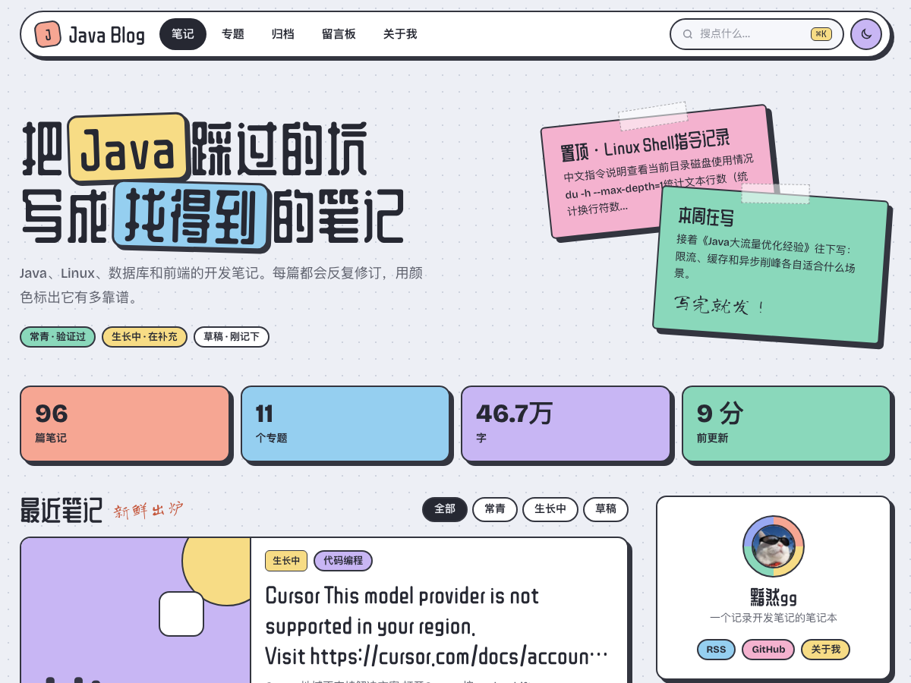

# 墨记 Moji Notes

手账贴纸风的 WordPress 笔记博客主题。要求 WordPress 6.0+、PHP 7.4+。



在线示例：[javablog.cc](https://javablog.cc/)

## 安装

点仓库页面的 **Code → Download ZIP** 下载，把解压出来的文件夹改名为 `moji-notes` 再重新压缩成 `moji-notes.zip`，然后在后台 **外观 → 主题 → 安装主题 → 上传主题** 上传并启用。

也可以直接在服务器上：

```bash
cd wp-content/themes && git clone https://github.com/AnRan-727/moji-notes.git
```

## 启用后建议做的几步

1. **建三个页面**（页面 → 新建，右侧“模板”里选择）：
   - `专题`：模板选“专题”，列出所有分类。
   - `归档`：模板选“归档”，按年月列出全部笔记。
   - `关于我`：模板选“关于我”。标题写成 `你好，我是{小岩}`，花括号里的字会变成粉色贴纸；页面“摘要”是标题下的介绍，正文写经历、工具等。
2. **菜单**：外观 → 菜单，建一个菜单放上这几个页面，位置勾“主导航”。
3. **专题颜色**：文章 → 分类，编辑每个分类，选“主题颜色”。不选会自动分配。
4. **自定义**：外观 → 自定义 → 墨记主题，可改首页大标题、便签、侧栏卡片、头像、邮箱、字体源等。
5. **固定链接**建议用“文章名”，反向链接识别更准。

## 写笔记时可用的功能

| 功能 | 怎么用 |
| --- | --- |
| 成熟度 | 编辑文章右侧“笔记信息”里选 草稿 / 生长中 / 常青。旧文章默认值可在自定义里设置。 |
| 手写批注 | 同一个面板里填，显示在文章标题区右上角。 |
| 双链 | 正文写 `[[文章标题]]` 或 `[[文章标题\|显示文字]]`，自动链接到同名文章；文章不存在时显示虚线。代码块里不会转换。 |
| 反向链接 | 自动显示“谁引用了这篇”：用 `[[标题]]` 或直接贴本文链接都算。 |
| 提示框 | 选中“段落”或“组”区块，右侧“样式”里选 **提示框 / 注意框 / 结论先行**。 |
| 目录 | 文章有两个以上 H2/H3 时自动生成，右侧跟随滚动并显示阅读进度。 |
| 代码块 | 自动加标题栏和“复制”按钮；`<code class="language-java">` 会显示语言名。 |
| 置顶 | 置顶文章显示在首页第一张粉色便签上。 |
| 搜索 | 点右上角搜索框，或按 `⌘K` / `Ctrl+K` / `/`，即时搜索标题、正文、标签和专题。 |

## 字体

标题用站酷庆科黄油体，手写批注用龙藏体，默认从国内镜像 `fonts.loli.net` 加载。访问慢的话可以在自定义里改成 Google Fonts 或“不加载”（改用系统字体）。

## 文件结构

```
style.css            主题样式与信息
functions.php        主题入口
inc/helpers.php      配色、成熟度、字数、统计、热力图
inc/meta.php         分类颜色、文章“笔记信息”面板
inc/content.php      双链、目录、反向链接
inc/customizer.php   自定义选项
inc/search.php       即时搜索接口 /wp-json/moji/v1/search
home.php             首页
single.php           笔记详情
archive.php          专题/标签/日期归档
template-*.php       专题、归档、关于我 页面模板
assets/js/theme.js   深色模式、搜索弹窗、目录、代码复制
```

## 许可

GPL-2.0-or-later，与 WordPress 相同。
